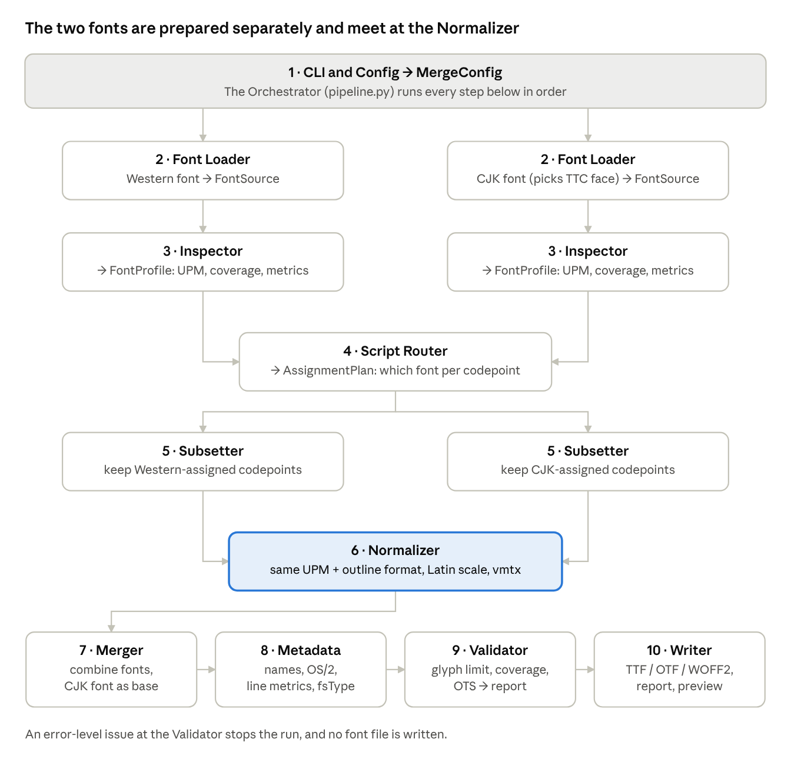

# Font Merge Tool — High-Level Design

Oct 30, 2026 · Chris Kuo

## Overview

The tool builds one font file from two: Latin and other Western scripts come from a **Western font**, and Chinese/Japanese scripts come from a **CJK font**. It is a Python command-line tool built on fontTools, organised as a pipeline of small modules that each pass a typed object to the next.

**Status:** built in 8 tested stages (307 tests) in the private repo chris-kuo/fontmerge. The first merge is Iansui Literata Light: Literata Light at 96% with Iansui. This doc has been updated to match the code. The font choices behind that merge are recorded in [font-selection.md](font-selection.md).

**Inputs**

- Western font: TTF, OTF, or one face from a TTC/OTC collection
- CJK font: TTF, OTF, or one face from a TTC/OTC collection (most CJK fonts ship as collections)
- Optional config file: which Unicode ranges go to which font, scaling and baseline tweaks, output names

**Outputs**

- One merged font: TTF or OTF, optionally WOFF2 for the web
- A validation report (coverage, glyph count, metric checks)
- An optional preview sheet (HTML/PNG) of mixed sample text

**Out of scope for v1:** variable fonts, colour fonts, keeping hinting, and building TTC collections. These are listed under future extensions.

## Tools and frameworks

Python 3.11+ with **fontTools** as the core. fontTools is the standard open-source library for reading and writing OpenType fonts. It already provides the hard parts this tool needs: subsetting, merging, changing units-per-em, and converting outline formats.

| Area | Choice | What it does here | Why |
| --- | --- | --- | --- |
| Language | Python 3.11+ | Whole tool | fontTools and the font QA tools are all Python |
| Font I/O | `fontTools.ttLib` (`TTFont`, `TTCollection`) | Load and save TTF, OTF, TTC, WOFF2 | Reads and writes every table, lazy loading for large CJK fonts |
| Subsetting | `fontTools.subset` | Keep only the glyphs each font contributes, with their OpenType features | Handles GSUB/GPOS closure and cmap pruning correctly |
| Units-per-em | `fontTools.ttLib.scaleUpem` | Rescale one font to the other's grid (for example 2048 to 1000) | Scales outlines, metrics and kerning together |
| Outline conversion | `fontTools.pens` + `cu2qu` / `qu2cu` | Convert CFF (cubic) to TrueType (quadratic) or back | Both fonts must share one outline format before merging |
| Merging | `fontTools.merge.Merger` | Combine the prepared fonts into one | Merges cmap, GSUB, GPOS and renames clashing glyph names |
| WOFF2 output | `brotli` | Compress for web delivery | Required by fontTools for WOFF2 |
| CLI | argparse (standard library) | Command-line interface and help text | No extra dependency to install |
| Config | Pydantic + TOML (`tomllib`) | Validate the merge config | Clear errors for bad ranges or values |
| Previews | HTML page; Pillow for PNG | Show the merged font on mixed sample text | In the HTML page a browser shapes the text for real |
| Validation | `opentype-sanitizer` (OTS), optional Font Bakery | Catch fonts that browsers or OSes would reject | OTS is what Chrome and Firefox run on web fonts |
| Testing | pytest + small open-licensed test fonts (Literata Light, Iansui) | Unit and end-to-end tests | Real-world fonts surface real edge cases |
| Packaging | `pyproject.toml`, uv, ruff, mypy | Install, lint, type-check | Install with `pipx install fontmerge` |

**Alternatives considered.** FontForge scripting can merge fonts but is GPL, harder to automate and gives less control over OpenType tables. Doing it by hand in a font editor (Glyphs, FontLab) does not repeat reliably. A GUI or web front end can come later as a thin layer over the same pipeline.

## Architecture

The tool is a straight pipeline with one fork: each font is loaded, inspected and subset on its own track, and the two tracks join at the Normalizer.



The Router is the only step that looks at both fonts before they join: it uses both profiles to decide which font owns each codepoint. Everything after the Normalizer works on a single font object.

## Module specs

There are ten modules plus one orchestrator. Each module is a pure function, or close to one: it takes the objects named below and returns a new one, and never writes files except the Writer and Previewer. This lets each step be tested on its own.

### 1. CLI and Config (`cli.py`, `config.py`)

Reads command-line arguments and the optional TOML file, applies defaults, and validates everything into one `MergeConfig`. This is the only module that knows about the command line. It uses argparse, and also offers `fontmerge inspect`, which shows what the tool sees in a font.

```python
def load_config(cli_args: dict, config_path: Path | None) -> MergeConfig
```

Example: `fontmerge --western Inter.ttf --cjk NotoSansCJK.ttc --cjk-face "Noto Sans CJK JP" -o Merged.otf`

### 2. Font Loader (`loader.py`)

Opens a font file and selects the right face from a collection, by index or by name. It records file type, outline format (TrueType `glyf` or CFF), and whether the font is variable, then rejects input it can't handle.

```python
def load_font(path: Path, face: int | str | None = None) -> FontSource
```

### 3. Inspector (`inspector.py`)

Reads facts about each font without changing it: units-per-em, glyph count, the codepoints it covers, vertical metrics, x-height, cap-height, ideographic em box, OpenType features, and embedding permissions (`OS/2.fsType`). Later modules plan from this profile.

```python
def inspect_font(src: FontSource) -> FontProfile
```

### 4. Script Router (`router.py`)

Decides which font supplies each codepoint. It starts from default Unicode ranges, then applies config overrides. Characters both fonts share, such as quotes, dashes and ellipsis, follow a policy: Western shapes, CJK shapes, or CJK shapes only in their full-width form. Codepoints neither font covers are reported, not silently dropped.

```python
def build_plan(western: FontProfile, cjk: FontProfile, cfg: RoutingConfig) -> AssignmentPlan
```

Default routing:

- **Western font:** Basic Latin, Latin-1, Latin Extended A/B, IPA, Greek, Cyrillic, general punctuation, currency symbols
- **CJK font:** CJK Unified Ideographs and extensions, CJK Symbols and Punctuation, Hiragana, Katakana, Bopomofo, Halfwidth and Fullwidth Forms, CJK Compatibility, Enclosed CJK
- **Configurable:** Hangul (off by default), shared punctuation, box-drawing and arrows

### 5. Subsetter (`subset.py`)

Cuts each font down to the codepoints the plan gives it, keeping the glyphs that OpenType features reach (ligatures, alternates, vertical forms such as `vert`/`vrt2`). This also frees glyph slots: removing the CJK font's own Latin glyphs is what keeps the result under the 65,535-glyph limit.

```python
def subset_font(src: FontSource, codepoints: set[int], opts: SubsetOptions) -> TTFont
```

### 6. Normalizer (`normalize.py`)

Makes the two subset fonts compatible so they can merge, and makes the Latin sit well beside the CJK. It changes units-per-em to match the CJK font, converts outlines to the output format, and optionally scales and shifts Western glyphs. The goal is for Latin x-height and baseline to look right next to ideographs. It also adds vertical metrics (`vmtx`) for Western glyphs so vertical Japanese and Chinese text still lays out.

```python
def normalize(western: TTFont, cjk: TTFont, plan: NormalizePlan) -> tuple[TTFont, TTFont]
```

### 7. Merger (`merge.py`)

Combines the two prepared fonts with `fontTools.merge.Merger`. It sets the CJK font as the base because it owns the vertical tables, and settles glyph-name clashes. It keeps each font's features working only on its own glyphs, so Latin kerning never touches ideographs.

```python
def merge_fonts(base: TTFont, addition: TTFont, opts: MergeOptions) -> TTFont
```

### 8. Metadata Builder (`metadata.py`)

Rewrites the tables that describe the font as a whole: the new family and style names in `name`, unique ID and version, and `OS/2` Unicode and code-page ranges. It sets line metrics that fit both scripts (`hhea`, `OS/2` typo/win) and uses the stricter of the two `fsType` embedding settings. It also records both source fonts and their licences in the name table. Whose line spacing to use is a setting: the CJK font's (default), the Western font's, the average of both, or the larger of both.

```python
def build_metadata(font: TTFont, w: FontProfile, c: FontProfile, cfg: NamingConfig) -> TTFont
```

### 9. Validator (`validate.py`)

Checks the result before it is written: glyph count ≤ 65,535, every planned codepoint mapped to the right source, no empty glyphs for mapped characters, sane metrics, and an OTS sanitizer pass. Each problem gets a severity, so a warning can still produce a file while an error stops the run.

```python
def validate(font: TTFont, plan: AssignmentPlan) -> ValidationReport
```

### 10. Writer and Previewer (`writer.py`, `preview.py`)

Saves the font in the requested formats and, if asked, renders a preview sheet of mixed text such as "Hello 世界 こんにちは 2026年" as an HTML page or a PNG. It also writes the validation report next to the font.

```python
def write_outputs(font: TTFont, report: ValidationReport, cfg: OutputConfig) -> list[Path]
def render_preview(font_path: Path, samples: list[str], out: Path) -> Path
```

### Orchestrator (`pipeline.py`)

Runs the modules in order, passes each one's output to the next, and stops at the first error-level problem with a clear message. The CLI calls it, and a future GUI or web front end would call it too.

```python
def run(cfg: MergeConfig) -> MergeResult
```

## Data models

Modules share eight typed objects, defined once in `models.py` as frozen dataclasses (Pydantic for the config ones). They are the contracts between modules: change a model and every module that uses it shows up in type-checking.

| Model | Made by | Used by | Main fields |
| --- | --- | --- | --- |
| `MergeConfig` | CLI and Config | Orchestrator, every module (its sub-configs) | `western: SourceSpec`, `cjk: SourceSpec`, `routing: RoutingConfig`, `normalize: NormalizeConfig`, `naming: NamingConfig`, `output: OutputConfig`, `metrics: MetricsConfig` |
| `FontSource` | Font Loader | Inspector, Subsetter | `path`, `face_index`, `ttfont: TTFont`, `outline: "glyf" \| "CFF" \| "CFF2"`, `is_variable` |
| `FontProfile` | Inspector | Router, Normalizer, Metadata | `upm`, `glyph_count`, `codepoints: set[int]`, `ascender`, `descender`, `line_gap`, `x_height`, `cap_height`, `ideo_embox`, `features: set[str]`, `fs_type` |
| `AssignmentPlan` | Script Router | Subsetter, Validator | `western: set[int]`, `cjk: set[int]`, `missing: set[int]`, `decisions: list[RouteDecision]` (codepoint, source, rule that chose it) |
| `NormalizePlan` | Orchestrator (from profiles + config) | Normalizer | `target_upm`, `target_outline`, `western_scale`, `western_baseline_shift`, `vertical_advance` |
| `MergeOptions` | Orchestrator | Merger | `base: "cjk"`, `glyph_name_suffix`, `feature_scope` |
| `ValidationReport` | Validator | Writer, Orchestrator | `issues: list[Issue]` (severity, code, message, codepoint/glyph), `glyph_count`, `coverage` |
| `MergeResult` | Orchestrator | CLI (or a GUI) | `outputs: list[Path]`, `report: ValidationReport`, `preview: Path \| None` |

## Key technical challenges

Most of the risk sits in the Normalizer and Router. The merge itself is the easy part once both fonts share a grid, an outline format and a clean split of codepoints.

| Challenge | Why it matters | How the design handles it | Module |
| --- | --- | --- | --- |
| 65,535-glyph limit | CJK fonts often use most of the limit (Noto Sans CJK uses nearly all of it), so adding Latin can overflow | Subset the CJK font to its assigned codepoints first; Validator fails hard if over | Subsetter, Validator |
| Different units-per-em | Western fonts often use 2048 or 1000 units, CJK fonts usually 1000 | Rescale the Western font to the CJK font's grid with `scaleUpem` | Normalizer |
| TrueType vs CFF outlines | One font table can't mix `glyf` and `CFF` outlines | Convert to one format (default: the CJK font's, since it has more glyphs) | Normalizer |
| Latin looks too small or sits too low | Latin glyphs sit on a baseline; CJK glyphs fill an em box, so default Latin often looks small beside ideographs | Optional scale and baseline shift, computed from x-height and ideographic em box, overridable in config | Normalizer |
| Shared punctuation | Quotes, dashes, ellipsis and middle dots look different in Latin and CJK typography | Router policy per character group, defaulting to Western shapes for ASCII-range punctuation and CJK shapes for full-width forms | Script Router |
| Vertical writing | Japanese and Chinese vertical text needs `vhea`/`vmtx` entries for every glyph, including Latin | Synthesize vertical advances for Western glyphs; keep the CJK `vert`/`vrt2` features | Normalizer, Merger |
| OpenType features leaking across scripts | Latin kerning or CJK `palt` could act on the wrong glyphs | Features stay scoped to their own glyphs and script tags (`latn`, `hani`, `kana`) | Merger |
| Line height | Mismatched ascender/descender values cause clipped or uneven lines | Take the larger extents of both fonts for `hhea` and `OS/2` win metrics; keep typo metrics consistent | Metadata Builder |
| Licensing | Many fonts forbid modification, and the most restrictive `fsType` must carry over | Inspector reads `fsType` and licence fields; the tool warns on restricted fonts and records both licences in the output | Inspector, Metadata Builder |
| Large files and memory | CJK fonts are 10–20 MB with tens of thousands of glyphs | Lazy table loading; subset before anything else touches outlines | Loader, Subsetter |

## Errors, testing and future extensions

**Error handling.** Each module raises a typed `FontMergeError` subclass (`UnsupportedFontError`, `GlyphLimitError`, `RoutingError`, and so on). The orchestrator catches these and the CLI prints one plain-language line with the fix, such as "Pick a face with `--cjk-face`; this .ttc has 10." Validator issues have three levels: info, warning (file still written) and error (no file written). `--strict` turns warnings into errors.

**Testing.**

- **Unit tests** per module, using tiny fonts built with `fontTools.fontBuilder`, so each test runs in milliseconds
- **Golden tests** on routing: a fixed list of codepoints and the source each must come from
- **End-to-end tests** on real fonts (Literata Light + Iansui, run through the command line), checking glyph count, coverage and an OTS pass
- **Source checks** in the Validator: every planned character must be present (no `.notdef`) and match its glyph in the font it was planned to come from
- **Visual check**: the preview sheet is kept as a CI artifact for a human to look at

**Future extensions.**

- Korean Hangul as a first-class route
- Variable font input (merge at a named instance, or keep axes when both fonts share them)
- Output as a TTC with Simplified Chinese, Traditional Chinese and Japanese variants sharing Latin glyphs
- A web or desktop GUI over `pipeline.run`
- A third font as fallback for symbols and emoji
