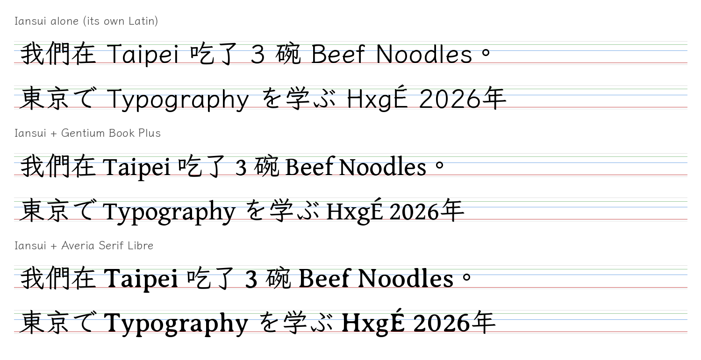
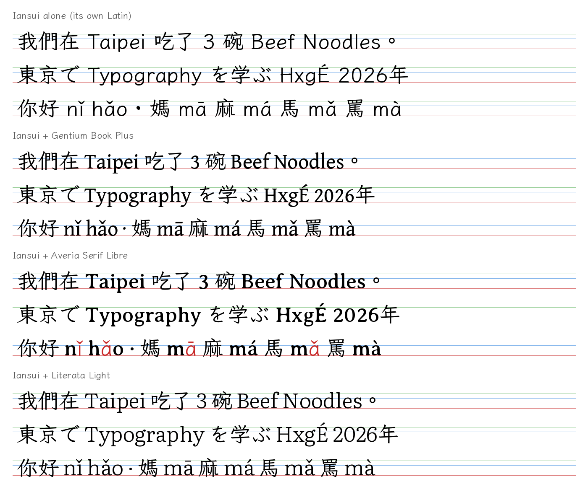
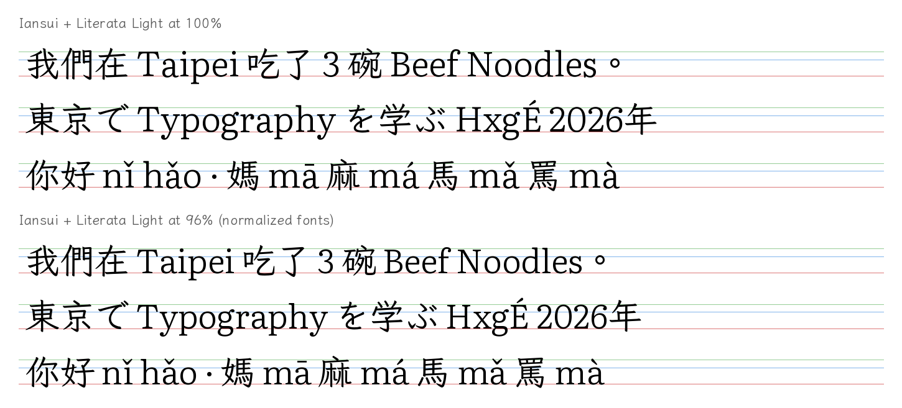
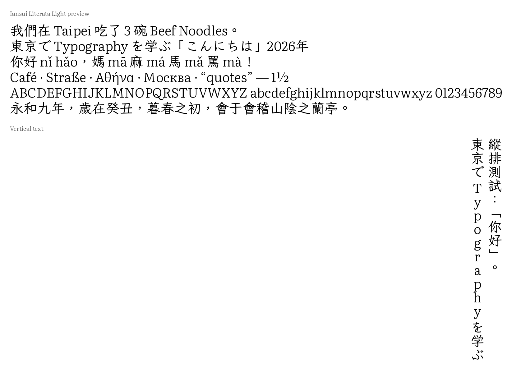

# Font selection: Iansui Literata Light

Oct 30, 2026 · Chris Kuo

The first merge pairs **Literata Light** (Western) with **Iansui Regular** (CJK, Traditional
Chinese with kana and Bopomofo). Three Western fonts were tried against Iansui before
settling on Literata Light. This page records what was compared and why each was kept or
dropped, so the settings in `examples/iansui-literata.toml` can be traced back.

## Comparison

All values are fractions of the em, so fonts with different units per em compare directly.
Iansui's own Latin is the reference: it was drawn to sit next to its ideographs.

| Measure | Iansui (reference) | Literata Light | Averia Serif Libre | Gentium Book Plus |
| --- | --- | --- | --- | --- |
| Stem weight (Han strokes ≈ 0.065) | 0.072 | **0.071** | 0.107 | 0.088 |
| x-height | 0.468 | 0.505 | **0.467** | 0.454 |
| Cap height | 0.695 | **0.701** | 0.677 | 0.615 |
| Lowercase width (average) | 0.515 | 0.537 | **0.522** | 0.479 |
| Line height | 1.12 | 1.49 | **1.21** | 1.47 |
| Pinyin tone letters (ā ǎ ē ě …) | – | **all** | 4 of 8 vowels missing | all |
| Greek / Cyrillic | – | **yes** | no | yes |
| Kerning | – | **GPOS** | legacy `kern` table | GPOS |
| Units per em | 1000 | **1000** | 2048 | 2048 |
| Vertical metrics | yes | **yes** | no | no |
| Licence | OFL | **OFL, no reserved names** | OFL, reserves "Averia" | OFL, reserves "Gentium", "SIL" |

Stem weight was measured from rendered glyphs (the vertical stem of `l` and `n`); the other
values come from the fonts' metrics and glyph bounds.

## Decisions

1. **Gentium Book Plus** (first try): its capitals are about 10% shorter and its letters
   narrower than Iansui's Latin, and its line height is much taller. Dropped.
2. **Averia Serif Libre**: height and width match Iansui almost exactly, but its strokes are
   about 50% heavier, so Latin reads as bold next to Iansui's thin, even strokes. It also
   covers only Latin-1, so pinyin tone letters such as ā and ǎ would fall back to Iansui
   and mix two styles inside one word. Dropped.
3. **Literata Light**: chosen. Its stem weight matches Iansui, it covers every pinyin tone
   letter plus Greek and Cyrillic, and it already uses a 1000-unit em with vertical metrics
   and GPOS kerning. Its one mismatch, an x-height about 8% taller than Iansui's, is handled
   by scaling.

## Settings chosen

| Setting | Value | Reason |
| --- | --- | --- |
| Western scale | 0.96 | Splits the difference: x-height 0.485 em (Iansui 0.468), cap height 0.673 em (Iansui 0.695). The automatic scale (geometric mean of the two ratios) gives the same value. |
| Line height | Iansui's (940 / −180 / 0 = 1.12 em) | Keeps Chinese text compact. All pinyin tone capitals stay under the 940 ascender (the tallest, Ǎ Ě Ǒ, reach 891). |
| Family / style | Iansui Literata / Light | Neither licence reserves a name. Weight class 300. |
| Shared punctuation | split | ASCII quotes and dashes from Literata, full-width forms and CJK marks (‥ ※) from Iansui. |
| Symbols | cjk | Arrows, boxes and circled numbers from Iansui, so they keep CJK widths. |

## Known limits

- **Tall capitals:** 35 rare Western letters reach above the 940 ascender: capital Ü with a
  tone mark (Ǖ Ǘ Ǚ Ǜ, up to 1060) and Vietnamese letters with stacked accents (up to 1076).
  Windows will not clip them (its clipping metrics cover every glyph), but with 1.12 em line
  spacing their accents can touch the line above. `--line-height max` (1.49 em) clears them.
- **Fallbacks to Iansui:** IPA symbols, Roman numerals (Ⅰ–Ⅻ), most math operators and a few
  letterlike symbols (℃ №) are not in Literata and come from Iansui.
- **Half-width forms:** applying Iansui's `hwid` feature to full-width Latin gives Iansui's
  Latin shapes, not Literata's.

## Result

The merged font has 16,157 glyphs and 13,301 characters: 1,147 from Literata and 12,154
from Iansui. It validates with no errors or warnings.
