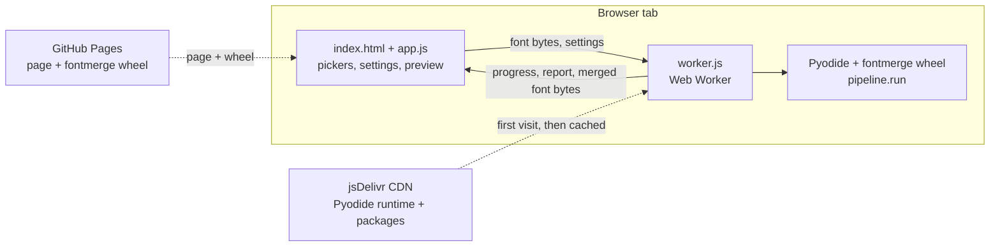

# Web app plan: fontmerge in the browser

Oct 30, 2026 · Chris Kuo

**Decision:** run the existing `fontmerge` Python package inside the browser with
[Pyodide](https://pyodide.org) and publish the page on GitHub Pages. Fonts never leave the
user's computer, there is no server to run or pay for, and the merge code stays the same
code the CLI uses. The cost is speed: a merge the size of Iansui Literata Light, which takes
about 18 s natively, is expected to take 1–2 minutes in the browser. Stage W1 measures this
before any UI work.

## Why in-browser (option A)

| | A. In the browser (chosen) | B. Hosted server | C. Local web UI |
| --- | --- | --- | --- |
| Where fonts go | Stay on the user's computer | Uploaded to a server | Stay on the computer |
| Hosting | Free static page (GitHub Pages) | Paid server | None |
| Speed for a large CJK merge | ~1–2 min (to be measured) | ~20 s | ~20 s |
| Who can use it | Anyone with the link | Anyone with the link | Only the person running it |

Many commercial font licences forbid uploading the font to third-party servers, so a tool
that never uploads works with more fonts. All needed packages are built for Pyodide:
fontTools 4.62.1, brotli 1.2.0, pydantic 2.12.5, Pillow 12.2.0
([Pyodide package list](https://pyodide.org/en/latest/usage/packages-in-pyodide.html)).

## How it works



1. The user picks two font files. The page reads them as bytes; nothing is uploaded.
2. A **Web Worker** runs Pyodide, so the page stays responsive during a long merge.
3. The worker loads Pyodide and its packages from the jsDelivr CDN (pinned version,
   cached by the browser after the first visit), then installs the `fontmerge` wheel served
   from the same site with `micropip`.
4. Font bytes are written into Pyodide's in-memory file system and passed to the existing
   pipeline. Progress messages from `pipeline.run` are posted back to the page as they happen.
5. The worker returns the merged font bytes, the validation report and the font profiles.
   The page shows a live preview using the browser's own text engine (real shaping, including
   vertical text) and offers downloads.

No special server headers are needed (the app does not use SharedArrayBuffer), which matters
because GitHub Pages cannot set custom headers.

## Changes to the Python package

Small and additive. The CLI keeps working unchanged.

| Change | Why |
| --- | --- |
| New `fontmerge/web.py`: `inspect_bytes(data, face)` and `merge_bytes(western, cjk, settings, progress)` | A bytes-in, bytes-out entry point for the worker; it writes to a temporary in-memory folder, calls `pipeline.run`, and returns the font bytes, report and profiles as plain dicts that cross into JavaScript cleanly |
| `merge_bytes` accepts settings as a dict shaped like the TOML config | The form maps one-to-one onto the config, so validation errors name the same settings as the CLI |
| No Pillow or brotli at import time | Pillow is not needed in the browser; brotli is loaded only for WOFF2 output |

`web.py` is tested with pytest under normal Python like every other module, so most bugs are
caught without a browser.

## Repository layout

```
web/
  index.html      page structure
  app.js          UI: file pickers, settings form, progress, preview, downloads
  worker.js       loads Pyodide, installs the wheel, runs inspect/merge
  style.css       light and dark themes
  samples.js      default preview text (mixed CJK + Latin, vertical sample)
src/fontmerge/web.py
tests/test_web.py           pytest for the adapter (CPython)
tests/browser/              Playwright end-to-end tests (run in CI)
.github/workflows/ci.yml    tests, lint, type check on every push and pull request
.github/workflows/pages.yml build the wheel, assemble the site, deploy to GitHub Pages
```

## The page

- **Western font** and **CJK font** pickers (drag and drop or browse). After each pick the
  page shows the font's name, units per em, glyph count, coverage and licence, using the
  Inspector. For a `.ttc`, a menu lists the faces.
- **Settings**, with the CLI defaults: family and style name, Western scale (the automatic
  value is filled in and can be changed), line height, punctuation, symbols, Hangul, output
  formats. Reserved Font Names are flagged as you type the family name.
- **Merge** button, with stage-by-stage progress (the same steps the CLI prints).
- **Results:** an editable preview (horizontal and vertical text, adjustable size), the
  validation report (errors, warnings, notes), and downloads: TTF or OTF, WOFF2, report JSON.
- A short notice: fonts are processed on your device and never uploaded; the merged font is
  governed by the source fonts' licences.

## Implementation stages

Each stage ends with passing tests and is confirmed with Chris before the next one starts.
Tests run locally where possible; anything that needs Pyodide runs in GitHub Actions, because
the development workspace cannot reach the Pyodide CDN.

| Stage | Builds | Tests | Done when |
| --- | --- | --- | --- |
| **W1. Proof of concept** | `web.py` adapter; a bare page and worker that run `merge_bytes` on two picked files and offer the result for download; `ci.yml` | pytest for `web.py`; a Playwright test in CI that merges the generated test fonts in headless Chromium and checks the output with fontTools; timing and peak memory for Literata Light + Iansui | The browser output matches the CLI output (same glyphs, characters and metrics), and the real merge time and memory are known |
| **W2. Inputs and settings** | Font pickers, Inspector summaries, `.ttc` face menu, settings form with automatic scale, Reserved Font Name check, progress display, cancel | pytest for `inspect_bytes`; Playwright: pick fonts, see summaries, choose a face, change settings, see progress | Every CLI option that matters for a merge can be set from the page |
| **W3. Results** | Live preview (horizontal, vertical, editable text and size), report view, downloads (TTF/OTF, WOFF2, report JSON), light/dark theme, error messages with hints | Playwright: run a merge, preview uses the merged font, downloads open in fontTools, an error case shows its hint | A full merge can be done and checked without leaving the page |
| **W4. Public deployment** | `pages.yml`, GitHub Pages switched on, README link and badge, live-site smoke test | The deploy workflow runs the browser tests before publishing; a scheduled test checks the live site weekly | The site is live and a merge works there in Chrome, Firefox and Safari (desktop) |

## Public deployment plan

**Host: GitHub Pages**, built and published by a GitHub Actions workflow from the public repo.

| Item | Plan |
| --- | --- |
| Address | `https://chris-kuo.github.io/fontmerge/`. Optional custom domain (for example a subdomain of chriskuo.com) with a `CNAME` record; GitHub provides the HTTPS certificate. |
| Cost | Free. The site itself is under 1 MB (page plus a roughly 100 KB wheel); the large Pyodide runtime comes from jsDelivr, so it does not count against GitHub Pages bandwidth. |
| Limits | GitHub Pages allows sites up to 1 GB and about 100 GB of bandwidth a month (soft limit), and is not for commercial SaaS ([GitHub Pages limits](https://docs.github.com/pages/getting-started-with-github-pages/github-pages-limits)). A free, non-commercial tool is within the intended use. |
| What gets published | Only the `web/` folder plus the freshly built `fontmerge` wheel. The test fonts and Python sources are not part of the site. |
| When it publishes | On every push to `main`, after the tests (pytest, ruff, mypy, Playwright) pass. A failing test blocks the deploy. Manual re-run is available from the Actions tab. |
| Versioning | The page footer shows the fontmerge version and the commit it was built from, so a report can be traced to the exact code. Tags (`v0.2.0`, …) mark releases. |
| Pyodide version | Pinned to one exact release in a single constant in `worker.js` (currently Pyodide 314.0). Upgrades are a one-line change tested in CI like any other change. |
| Reliability | If jsDelivr were ever unavailable, Pyodide's core files and the four needed packages (about 20 MB) can be served from the site itself instead; this stays a fallback, not the default. |
| Privacy | No analytics, cookies or tracking. Fonts are processed in the browser and never sent anywhere. The only network requests are for the page, the wheel and the Pyodide files. |
| Monitoring | A weekly scheduled workflow opens the live site in headless Chromium and runs a small merge; a failure opens a GitHub notification. |
| Rollback | Re-run the deploy workflow on an earlier commit, or revert the commit on `main`. |

**One-time setup Chris does on GitHub** (about two minutes): Settings → Pages → Source:
"GitHub Actions". Everything else is in the workflow files.

## Risks and how they are handled

| Risk | Effect | Mitigation |
| --- | --- | --- |
| Merge is slow in the browser | Large CJK merges may take minutes | Measured in W1. Progress display and cancel; if needed, skip the slowest optional step (the per-glyph source check) in the browser |
| Memory | A 10–20 MB CJK font expands in memory; phones may run out | Measured in W1; the page warns on small devices and recommends a desktop browser |
| First-visit download | Pyodide and packages are 15–20 MB | Downloaded once and cached; the page shows loading progress |
| Pyodide differences from CPython | A dependency could behave differently | The W1 test compares browser output with CLI output glyph for glyph |
| Dev workspace cannot reach the CDN | Browser tests cannot run there | Browser tests run in GitHub Actions; Chris spot-checks each stage in his own browser |

## Decisions to confirm

1. Page language: English only, or English with a Traditional Chinese (繁體中文) toggle?
2. Address: the default `chris-kuo.github.io/fontmerge`, or a custom domain?
3. Output formats offered by default: TTF and WOFF2 (suggested), plus OTF on request?
